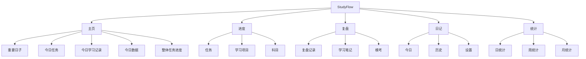
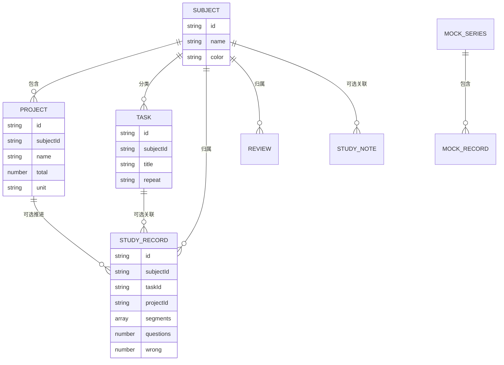
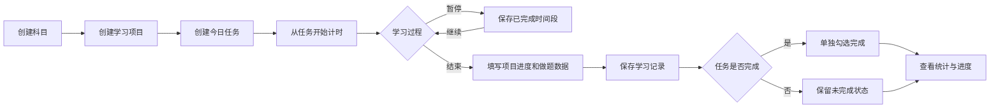
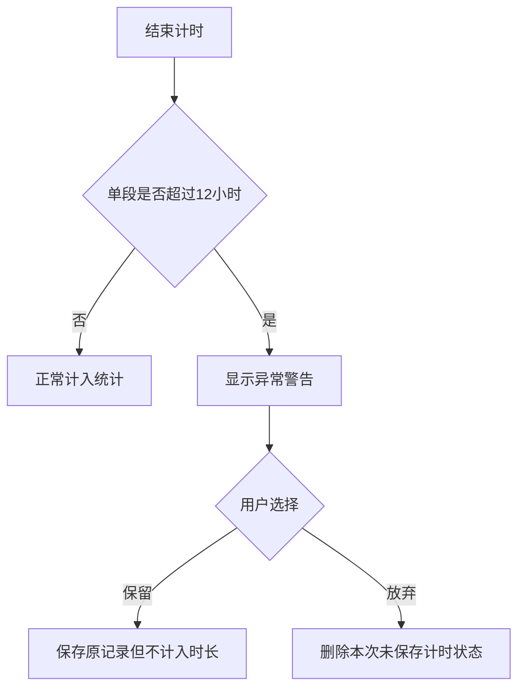

# StudyFlow 产品设计材料

## 1. 信息架构

## 2. 核心对象关系

## 3. 核心用户流程

## 4. 关键交互逻辑

### 4.1 任务与记录分离

计时器从任务进入，但计时结果只生成学习记录，不直接改变任务完成状态。这样可以覆盖以下真实情况：

- 用户学习了 40 分钟，但没有达到任务要求。
- 用户不用计时器也完成了任务。
- 同一任务分多次学习后才完成。

### 4.2 项目在记录阶段选择

任务必须选择科目，但不强制选择项目。计时结束或手动记录时，用户才决定本次学习是否推进某个项目。这样既能支持同科目下多个题本，也减少创建任务时的设置成本。

### 4.3 历史未完成任务

过去未完成的任务不自动删除，也没有“跳过今天”。用户可以在历史未完成列表中补做，完成后原日期的统计状态随之更新。

### 4.4 连续时间轴

日统计按照真实开始和结束时间展示学习、生活事件、随手记和空白时间。学习块长度反映持续时间；空白块帮助用户识别一天中没有记录的时间段。

### 4.5 异常计时处理

## 5. 页面设计说明

### 主页

优先级从“接下来要做什么”到“整体是否在推进”：

1. 重要日期
2. 今日任务
3. 今日学习记录
4. 今日数据与科目构成
5. 整体任务进度与历史未完成

### 进度

将任务、项目和科目放在同一一级页面，减少底部导航数量。任务解决短期行动，项目解决长期数量进度，科目提供统一分类。

### 复盘

复盘记录、学习笔记和模考都属于“学习后回看”，因此合并到同一导航下，通过二级标签切换。

### 日记

生活记录不与学习统计混成同一指标，但可以在同一天时间轴中共同呈现，让用户理解学习行为所处的生活上下文。

### 统计

- 日：回答“今天发生了什么”。
- 周：回答“最近一周是否稳定”。
- 月：回答“长期投入和完成情况如何”。

## 6. 主要状态设计

| 状态 | 处理方式 |
| --- | --- |
| 无科目 | 引导创建第一个科目 |
| 无任务 | 提供新增任务按钮 |
| 无学习记录 | 说明可通过计时或手动补录产生记录 |
| 输入错误 | 在表单内显示具体错误，不关闭表单 |
| 删除 | 二次确认并说明影响范围 |
| 数据保存成功 | Toast 提示并立即刷新相关统计 |
| 计时恢复 | 显示正在运行或暂停状态 |
| 异常时长 | 保留记录、停止计入并显示警告 |
| 图片失败 | 保留表单并提示更换图片 |

## 7. 移动端设计原则

- 底部五栏导航，核心模块一跳可达。
- 表单使用底部弹层，减少页面跳转。
- 主要按钮保持适合触控的高度。
- 长列表使用卡片与二级筛选，避免横向复杂表格。
- 统计图在窄屏下优先保证数值与趋势可读性。

## 8. 待补充视觉材料

- 首页完整截图
- 创建任务和计时结果表单
- 进度页三种状态
- 复盘档案柜和错误标签统计
- 模考动态趋势前后对比
- 日统计连续时间轴
- 周/月统计页面
- 异常计时警告状态

