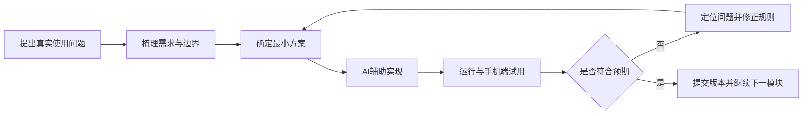
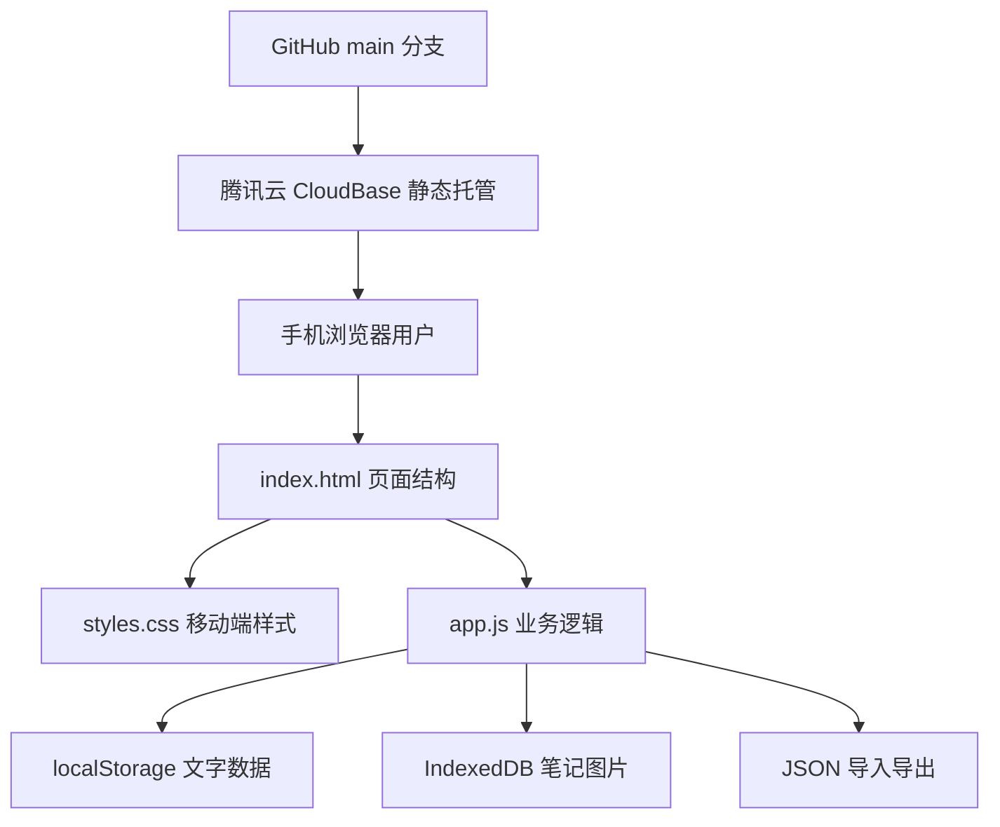

# StudyFlow 开发与落地材料

## 1. 开发方式

StudyFlow 采用 Vibe Coding 的协作方式完成。我负责产品方向、业务判断、需求优先级、交互规则和最终验收，AI 作为产品分析、设计、开发和测试辅助工具参与落地。

这种协作并不等于一次性生成代码，而是持续经历以下循环：



## 2. 个人职责

### 我主导的内容

- 确定产品定位和目标用户。
- 提出使用场景和真实痛点。
- 判断功能是否必要，并持续收缩需求范围。
- 定义科目、项目、任务和学习记录之间的业务关系。
- 确定统计、正确率、任务补做和异常计时等规则。
- 在手机端试用并提出交互问题。
- 验收功能是否真实可用，而不是静态视觉稿。
- 决定部署方式和版本迭代顺序。

### AI 辅助的内容

- 将自然语言需求拆解为功能和验收条件。
- 提供技术方案和风险提示。
- 编写 HTML、CSS 和 JavaScript。
- 执行代码检索、语法检查和边界测试。
- 协助定位计时、统计、缓存与部署问题。
- 维护 Git 提交并同步远程仓库。

## 3. 技术架构



### 为什么选择原生前端

- MVP 不需要复杂路由、服务端渲染或组件生态。
- 减少依赖和构建步骤，适合快速验证。
- 静态文件便于部署到国内可访问的托管平台。
- 对编程初学者更容易理解文件职责。

### 为什么选择本地存储

- 首版没有账号和跨设备需求，避免过早引入后端。
- 用户可在不注册的情况下快速开始。
- 学习与日记内容默认保留在当前设备，降低服务端隐私风险。

### 本地存储限制

- 换设备或清除浏览器数据后无法自动恢复。
- 不适合多人使用和跨端同步。
- 图片存储受浏览器容量限制。
- 需要用户主动导出备份。

## 4. 数据结构概览

应用状态以一个主对象保存在浏览器中，包含：

- `countdowns`：重要日期和阶段
- `subjects`：科目
- `projects`：学习项目
- `tasks`：任务定义
- `taskStates`：具体日期的任务完成状态
- `records`：学习记录和时间段
- `reviews`：复盘记录和标签
- `studyNotes`：学习笔记元数据
- `mockSeries` / `mockRecords`：模考数据
- `journal`：日记、生活事件和自问回答
- `timer`：当前计时状态

学习笔记图片单独保存在 IndexedDB，导出备份时再与文字数据合并。

## 5. 关键工程决策

### 5.1 计时状态恢复

计时器保存当前状态、已结束时间段和正在运行时间段的开始时间。页面重新打开时，通过真实时间戳恢复经过时间，而不是依赖可能被浏览器暂停的定时器回调。

### 5.2 任务实例与任务定义分离

重复任务只保存一份任务定义，具体日期的完成状态以 `任务ID|日期` 作为键存储。这样既能生成每天的任务实例，也能保留历史完成情况。

### 5.3 统计统一来源

学习时长以学习记录中的时间段为唯一来源。日、周、月和科目统计使用相同的时间区间计算，减少不同页面口径不一致。

### 5.4 图片处理

图片在浏览器端压缩后保存，限制单条笔记最多 3 张，降低本地容量压力。导出时图片被包含在备份文件中。

## 6. 部署过程

### 版本管理

- 代码托管：GitHub
- 仓库：<https://github.com/zhangyr321-ui/studyflow>
- 主分支：`main`

### 托管方案

早期预览地址在部分国内网络环境下被安全服务阻止，因此迁移到腾讯云 CloudBase 静态网站托管。项目通过压缩包完成首次部署，后续连接 GitHub 实现版本更新。

### 缓存处理

静态资源使用查询参数版本号，例如：

```html
<link rel="stylesheet" href="styles.css?v=20261101-1">
<script src="app.js?v=20261101-1"></script>
```

发布关键修改时更新版本号，降低手机浏览器继续使用旧文件的概率。

## 7. 真实版本记录

| 日期 | Git 提交 | 主要内容 |
| --- | --- | --- |
| 2026-10-24 | `6e95b73` | StudyFlow 首版 MVP |
| 2026-10-24 | `5af50d7` | 手动学习记录支持分钟级时间 |
| 2026-10-25 | `2b4750c` | 独立学习记录和模考模块 |
| 2026-10-25 | `3c38ffa` | 学习记录显示项目单位 |
| 2026-10-25 | `ce1a382` | 学习笔记和紧凑连续时间轴 |
| 2026-11-01 | `3c41c3a` | 修复异常时长统计并优化模考趋势 |

## 8. 安全与隐私考虑

- 当前无账号、密码和服务端密钥。
- 用户输入在显示前进行 HTML 转义，降低注入风险。
- 数据默认只保存在当前浏览器。
- 对清空数据、删除记录等操作提供二次确认。
- 不把“前端隐藏按钮”当作权限控制；未来接入账号后必须增加服务端鉴权和数据库访问规则。

## 9. 工程限制与升级路径

如果进入真实用户阶段，建议升级为：

1. 前端继续保持移动端 Web App。
2. 增加账号认证和云数据库。
3. 数据按用户隔离，并配置服务端权限策略。
4. 设计本地数据迁移到云端的确认流程。
5. 增加日志、异常监控、备份和恢复能力。
6. 在数据与隐私边界明确后再增加 AI 功能。

